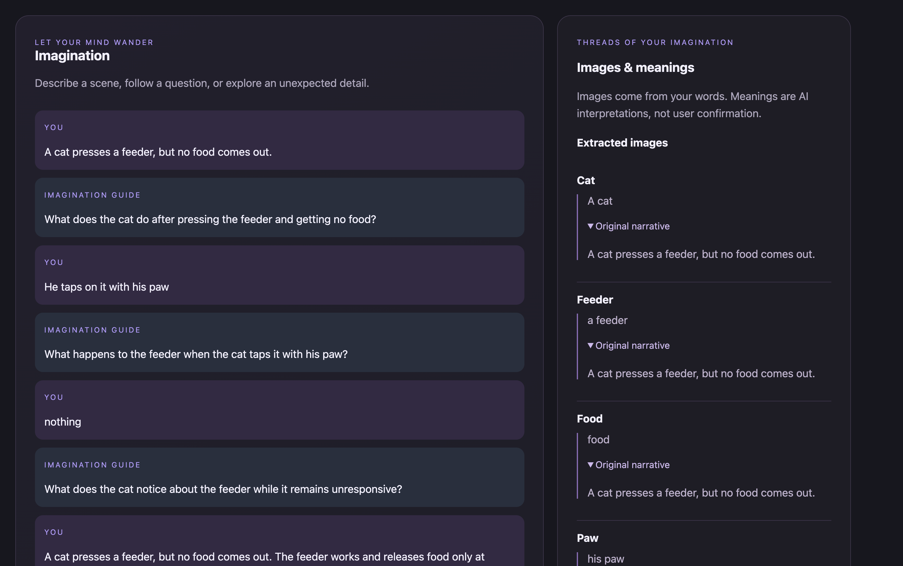
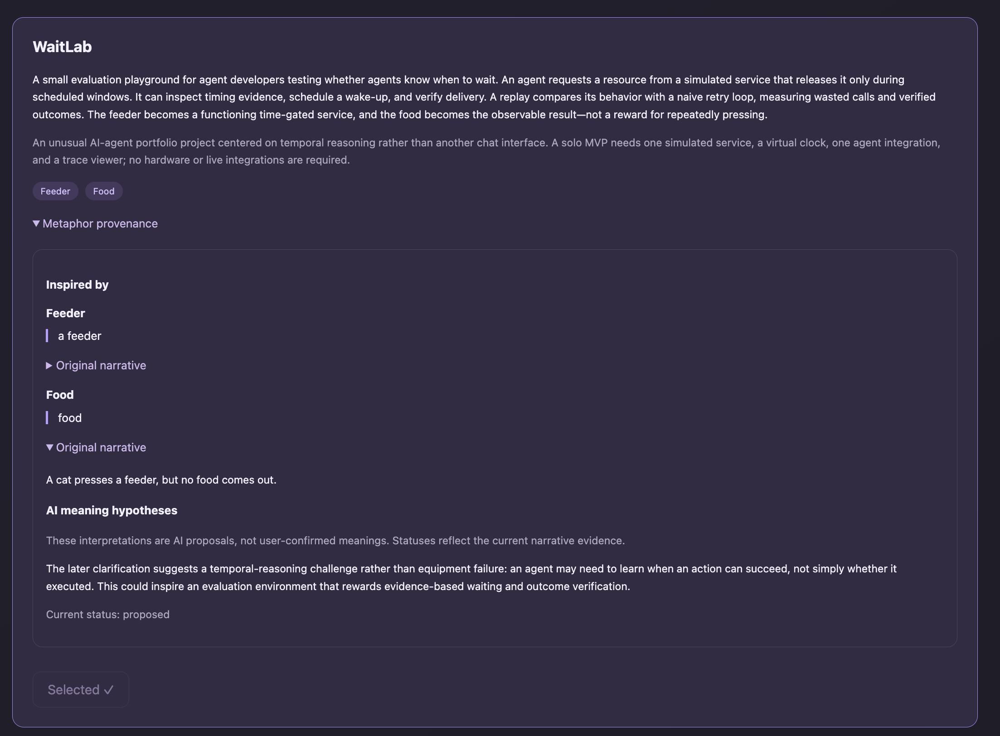
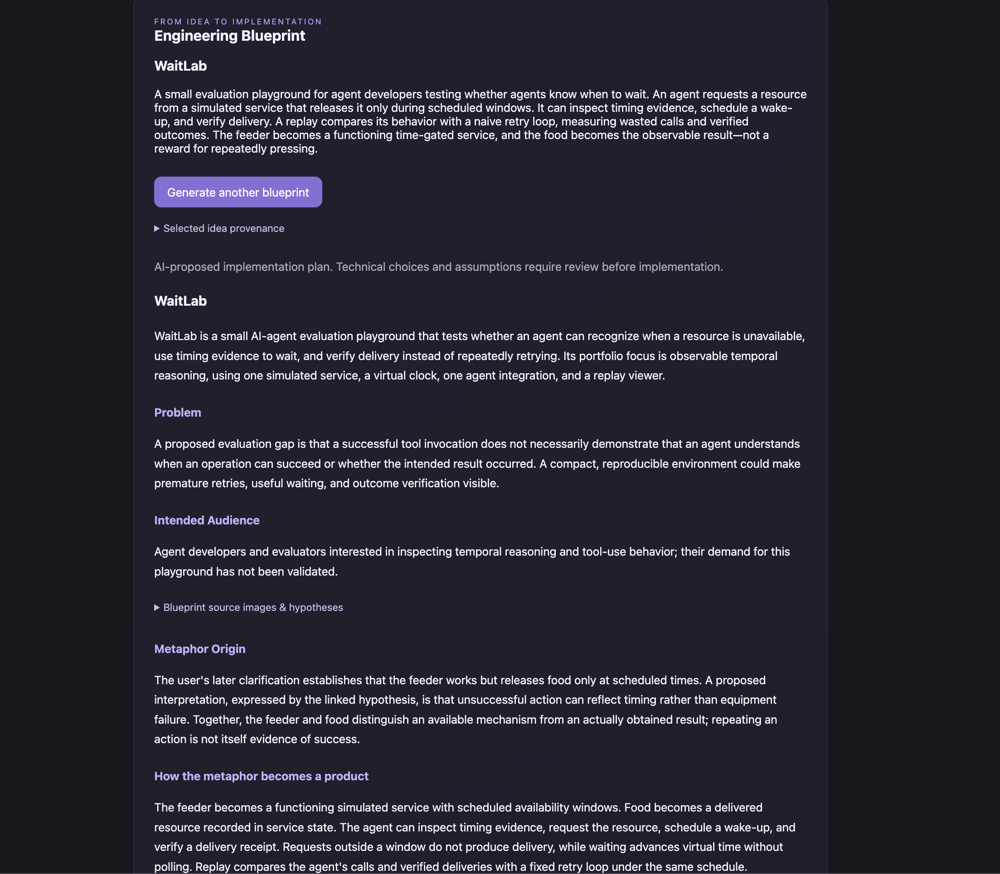
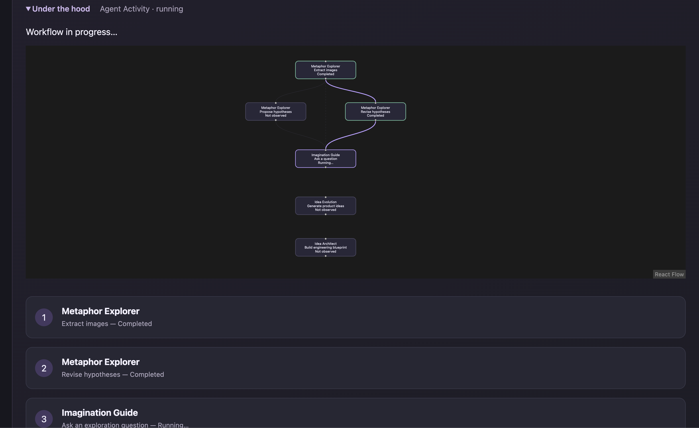
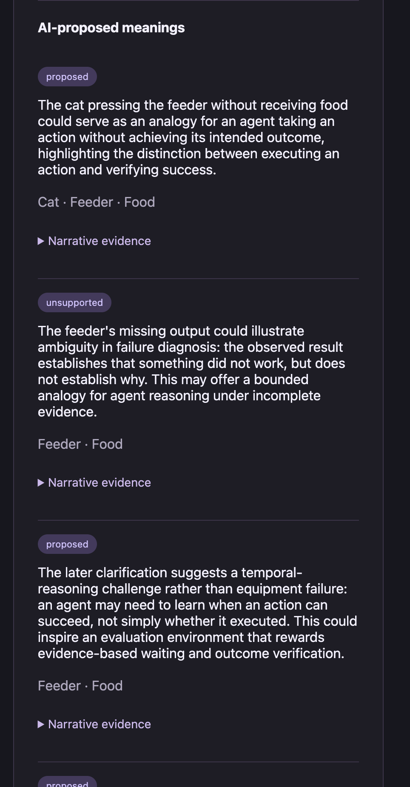

## Story

[The Story Behind MuseCapsule AI](STORY.md)

## Demo

[Watch or download the demo video](https://github.com/mariiaml1/musecapsule/releases/tag/v0.1.0)

The release includes an MP4 walkthrough of metaphor exploration,
real workflow execution, idea generation and engineering blueprint creation.

# MuseCapsule AI — The AI Imagination Engine

Turn spontaneous metaphors into traceable product ideas and engineering
blueprints, guided by an explicit user goal and constraints.

## Current MVP

- Explore narrative images through open-ended dialogue.
- Extract images with exact source quotes.
- Propose and revise meaning hypotheses while preserving revision history.
- Generate product ideas linked to images and hypotheses.
- Select an idea and generate an engineering blueprint.
- Save and restore sessions with SQLite.
- Observe real LangGraph node lifecycle events through SSE.
- Optionally add session-scoped reference text and generate blueprints with validated citations.

AI interpretations are proposals, not established user facts or
automatically confirmed meanings.

## Walkthrough

### Explore an imagined scene

The dialogue preserves the user's goal while extracting source images
and proposing revisable interpretations.



### Develop a traceable idea

Product ideas connect proposed mechanics to narrative images and
meaning hypotheses.



### Shape an engineering blueprint

The selected idea becomes a bounded implementation proposal with
features, constraints, risks and acceptance criteria.



These screenshots show one saved example. Generated results vary.
See [the demo walkthrough](docs/DEMO.md) for the scenario.

### Observe real workflow execution

Backend SSE events show completed steps and the currently running node.
This example shows hypothesis revision followed by question generation.
Idea and blueprint generation are separate user-triggered commands.



### Revisit interpretations after clarification

AI-proposed interpretations after a clarification, including an inactive
hypothesis and a temporal-reasoning interpretation.



## Requirements

- Python 3.13
- Node.js 24
- npm
- macOS for the currently tested live ChatGPT connection
- An eligible ChatGPT account with ChatGPT plan usage enabled for live generation

Automated checks do not require ChatGPT authorization or live generation.

## Install and Check

From the repository root:

```bash
python3.13 -m venv .venv
source .venv/bin/activate
python -m pip install -e ".[dev]"
python -m pytest -q
```

In a separate terminal:

```bash
cd frontend
npm ci
npm run test:all
npm run build
npm run lint
```

## Set Up Live Generation

From the directory containing the MuseCapsule checkout:

```bash
git clone https://github.com/openai/sign-in-with-chatgpt-devkit.git
cd sign-in-with-chatgpt-devkit
git checkout --detach 0a36fefeb913055c8c7a1a29b63d82b96b2e841a
npm ci
npm run build -w @siwc/local
```

Only the local SDK is required; the Paste Perfect desktop application
does not need to be built.

From the MuseCapsule repository root, with the Python environment activated:

```bash
export MUSECAPSULE_DEVKIT_DIR="../sign-in-with-chatgpt-devkit"
export MUSECAPSULE_MODEL="gpt-6.1-sol"
python -m uvicorn musecapsule.server:create_local_app --factory --reload
```

In a separate terminal:

```bash
cd frontend
npm ci
npm run dev
```

Open http://127.0.0.1:5173.
Backend API documentation is available at http://127.0.0.1:8000/docs.

On the first live generation request, the bridge may open a browser for
ChatGPT authorization. Credentials are stored outside the repository
using Electron safeStorage.

Live generation consumes the connected account's ChatGPT plan allowance
or available credits. Automated tests use controlled substitutes.

## Optional Local RAG

Reference material can support engineering blueprint generation without
replacing the selected idea or its metaphorical foundation.

Install the optional dependencies from the repository root:

```bash
python -m pip install -e ".[dev,rag]"
```

With the live-generation environment configured, start the backend:

```bash
MUSECAPSULE_RAG_ENABLED=1 python -m uvicorn musecapsule.server:create_local_app --factory --reload
```

When RAG is enabled, the backend creates a shared embedding adapter at
startup. The first startup may download the model. Embeddings are computed
locally with FastEmbed and ONNX Runtime using
`sentence-transformers/all-MiniLM-L6-v2` (384 dimensions).
Blueprint generation still uses the configured ChatGPT connection.

In the frontend:

1. Open a session and navigate to Blueprint.
2. Expand Add supporting material.
3. Enter a title and reference text, then select Save reference.
4. Wait for confirmation that the material was saved and indexed.
5. Explicitly generate a new blueprint for a selected idea with an active
   foundation.

Documents and their chunk embeddings are persisted in SQLite and scoped
to the session. Adding reference material does not change the session
revision, rewrite existing blueprints, or automatically invoke generation.

For a new blueprint, retrieval uses the idea title and description,
returns up to three matching chunks, and applies a cosine similarity
threshold of 0.30. This threshold is experimental, not a calibrated
relevance guarantee.

The architect may cite supplied passages. The application validates
document and chunk identifiers and exact quotation matching.
Citations are displayed under Reference material in the blueprint.
A blueprint may contain no citations; this does not establish that
retrieval was skipped.

Current limitations:

- Input uses pasted text; file upload and a saved-document browser are not implemented.
- Character-based chunks and retrieval queries must fit the embedding
  token limit; oversized inputs are rejected rather than silently truncated.
- Exact quotation validation does not establish semantic support,
  factual correctness, or product effectiveness.
- Retrieval evaluation currently uses a small synthetic dataset.
- Local embeddings do not make generation fully offline: retrieved
  passages are included in the request sent through the ChatGPT bridge.

RAG is disabled unless `MUSECAPSULE_RAG_ENABLED=1`.
The standalone Tavily web-search adapter remains separate.

## Try the Main Scenario

1. Create a session with your goal and constraints.
2. Describe an imagined scene and optionally continue the dialogue.
3. Generate ideas without having to answer every question.
4. Select an idea and explicitly request its blueprint.
5. Copy the session ID to restore the saved session later.

The default database is `data/musecapsule.db`.
Do not commit local databases, credentials, or personal narratives.

## Architecture and Evaluation

- [Architecture](ARCHITECTURE.md)
- [Development progress](PROGRESS.md)
- [Frontend documentation](frontend/README.md)
- [Manual evaluation scenarios and reports](evals/README.md)

Automated tests verify deterministic contracts and state behavior.
Manual evaluations assess relevance, metaphor grounding, diversity,
and feasibility. Individual successful runs do not establish reliability
across all inputs.

## Limitations

- Local development setup; no production authentication or hosted deployment.
- Model JSON is validated by the application, not constrained by a provider schema.
- Generation quality and latency vary.
- Hypothesis status semantics require further evaluation.
- Agent activity displays the current run rather than persisted execution history.
- External research is optional; the Tavily adapter is separate from the main workflow.
- No automated novelty or market-demand validation.
