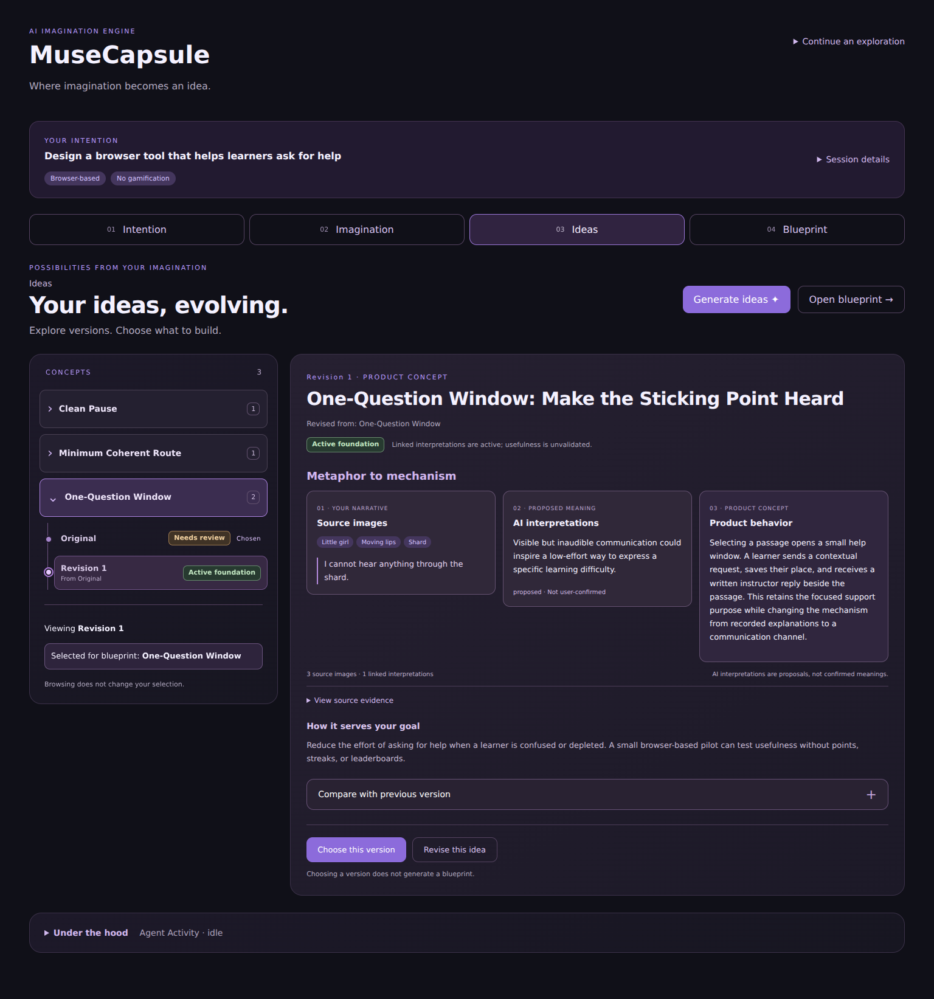

# MuseCapsule AI — Frontend

React + TypeScript interface for **MuseCapsule AI — The AI Imagination Engine**.

MuseCapsule transforms spontaneous human metaphors into structured product ideas and engineering blueprints, guided by the user's explicit goals and constraints.

## Tech Stack

- React
- TypeScript
- Vite
- CSS
- FastAPI backend
- LangGraph orchestration (backend)
- React Flow (@xyflow/react)

## Features

- Inspect the selected idea's source images and exact narrative quotes
- Review linked AI hypotheses and their current statuses
- Read the complete engineering blueprint, including constraints and risks
- Create a session with a goal and constraints
- Restore an existing session by ID
- Explore metaphors through an interactive dialogue
- Generate product ideas grounded in narrative images and meaning hypotheses
- Select an idea to develop
- Generate and view an Engineering Blueprint
- Restore saved session data
- Visualize the exploration workflow with React Flow
- Display real node start and completion statuses
- Highlight observed transitions in the sequential workflow

## Local Development

### 1. Start the backend

From the repository root, with the Python environment activated:

```bash
export MUSECAPSULE_DEVKIT_DIR="../sign-in-with-chatgpt-devkit"
python -m uvicorn musecapsule.server:create_local_app --factory --reload
```

The backend runs at `http://127.0.0.1:8000`.

### 2. Start the frontend

From the `frontend` directory:

```bash
npm ci
npm run dev
```

Open `http://127.0.0.1:5173`.

The Vite development proxy forwards `/api` requests to the local FastAPI backend.

## Quality Checks

```bash
npm run test:all
npm run build
npm run lint
```

## Creative Journey

Navigation changes only the current view, never session data or backend execution.

- **Intention** — enter a goal and constraints before creating a session. After
  creation, a compact goal summary replaces the form. Session restoration remains
  available from the header.
- **Imagination** — explore through dialogue, with extracted images, exact quotes,
  and AI-proposed hypotheses alongside it. Generate ideas once saved images exist;
  answering every clarification question is optional. Unsent text is excluded.
- **Ideas** — a concept sidebar groups explicit idea ancestry, with a separate
  detail pane for the version being viewed. Browsing versions never changes the
  persisted selection. Choosing a version saves the choice, then opens Blueprint
  without generating it.
- **Blueprint** — explicitly generate an engineering plan for the saved selection.
  The selected idea and the blueprint each expose their own source references.
- **Under the hood / Agent Activity** — collapsible, available from every view.
  Node activity comes from SSE events. Only terminal session completion confirms
  persistence; a failed follow-up read does not undo that confirmation.

Creation opens Imagination. Restoration opens Blueprint when an idea is selected,
Ideas when saved ideas exist, and otherwise Imagination. Navigation remains
available during a request; mutating actions stay disabled while it runs.
Draft text survives stage navigation and is cleared when opening another session.

## Idea Versions Workspace



The screenshot uses synthetic sample data with a mocked API.

- Original ideas and revisions are grouped only by `previous_idea_id`, never by
  title similarity. Each revision names its immediate parent, including branches.
- Current foundation badges distinguish active, inactive, missing, and legacy
  unlinked interpretations. Active does not mean user-confirmed or validated.
- Source images, proposed meanings, and product behavior use saved data. Product
  behavior uses the viewed version's saved blueprint mapping when available, or
  its original idea description. Full quotes remain available under source evidence.
- Comparison shows both saved descriptions verbatim, without LLM summarization.
- Successful revision opens the new proposal for inspection, leaving the chosen
  version unchanged. No blueprint is built automatically.
- Missing ancestors and circular histories remain visible with warnings.
- The sidebar stacks above details on narrow screens; all version controls are
  keyboard-accessible buttons.

## Frontend Structure

`App.tsx` retains session state and command handlers. `JourneyViews.tsx` contains
navigation, intention, dialogue, and exploration sources. `IdeasView.tsx` and
`BlueprintView.tsx` render saved products. `idea-versions.ts` handles ancestry and
foundation status, and `IdeasView.css` contains responsive workspace styling. `IdeaOrigin.tsx` resolves provenance.
`AgentActivity.tsx` contains the existing graph and lifecycle presentation.
`api.ts`, `agent-events.ts`, and `flow-path.ts` retain their existing contracts.
No backend changes are required.

## Tests

`npm test` runs the existing SSE parser, stream contract, and observed-transition
tests. `npm run test:ui` runs Vitest and React Testing Library in jsdom. These UI
tests use mocked API functions and graph rendering, so no LLM account or running
backend is required. `npm run test:all` runs both suites. Browser visual QA and a
live backend smoke test remain separate checks.

## Current Limitations

- Idea revision currently uses the JSON endpoint, not SSE node events. Its loading
  indicator does not simulate Agent Flow activity.

- Live execution events cover narrative exploration, idea generation,
  and engineering blueprint generation.
- Each command runs separately and persists its final session once.
- Idea selection is deterministic and does not invoke an LLM.
- Agent Flow displays the latest request; execution history is not persisted.
- Disconnected diagram nodes represent separate user-triggered commands.
- Execution events are shown for the current browser interaction and are
  not persisted as run history.
- Interrupted streams require reloading the session before retrying;
  requests are not automatically repeated.
- The interface is intended for local development.
- Generated meanings are AI proposals, not automatically confirmed user interpretations.
- External research is not required to generate ideas or blueprints.
- Diagram topology is maintained in the frontend to match the backend workflow.
- Observed transitions are derived from sequential node events;
  parallel execution is not supported by this visualization.
